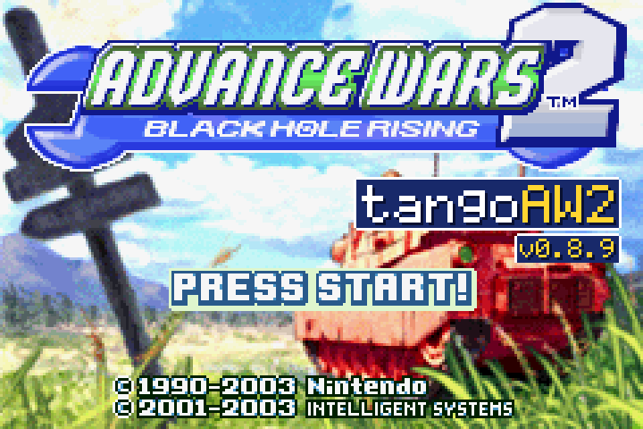
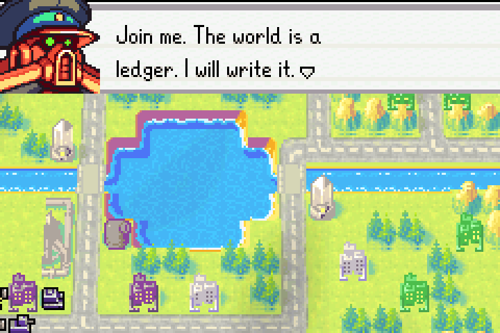
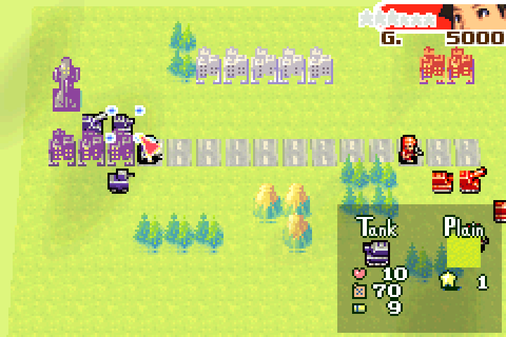

# tangoAW2

Rollback netplay for **Advance Wars 2: Black Hole Rising** (GBA, USA).

A fork of [Tango](https://github.com/tangobattle/tango) (mGBA, rollback,
matchmaking) for Advance Wars 2. Both players run the real game in its own
Versus mode; your ROM is never modified (changes are applied in memory).
No game is included: you need your own dump of the USA cartridge.

<table>
<tr>
<td></td>
<td></td>
<td></td>
</tr>
</table>

## Get it

Download the latest build from
[Releases](https://github.com/rkoh46/tangoAW2/releases/latest) (what
changed is in each release's notes): Windows (`.exe` installer), macOS on
Apple Silicon (`.dmg`, not signed: right-click the app and choose Open the
first time), Linux (`.AppImage`), or iPhone and iPad (`.ipa`, iOS 16 or
later: install it with [AltStore](https://altstore.io),
[SideStore](https://sidestore.io) or [Sideloadly](https://sideloadly.io);
it plays with on-screen buttons or a controller at 60 to 120 Hz, sideways
fitted between the buttons or stretched (Settings > Graphics), and online with
desktop players).

## First run

1. Open tangoAW2 and pick a nickname.
2. Put your Advance Wars 2 ROM in the `roms` folder the welcome screen
   shows: No-Intro `Advance Wars 2 - Black Hole Rising (USA)`, CRC32
   `5AD0E571`.
   (on iPhone, import it from the welcome screen; the Dual Strike `.nds`
   goes there too).
3. Press **Play**. Everything, online play included, is inside the game.

## Playing online

You both need tangoAW2 (same version) and your own copy of the ROM.

**From inside the game** (the usual way): press **Play**, then on Select
Mode pick **ONLINE**. Set your **gamertag** there first (it is shown beside
your army and kept in your settings).

- **UNRANKED** pairs you with a random opponent (same version). You each
  propose a 2-player map, the game picks one of the two, then you pick CO
  and colour; the rules are fixed (no fog, clear weather, 1000 funds, no
  limits, CO powers on).
- **LOBBY** lists the open lobbies (every lobby is public; a padlock marks
  password ones, a wrong password is told to you), or type a room code.
  **CREATE** makes a room for up to **five players** (optional password) and
  shows its code.
- In the room everyone presses **A** (READY); the host presses **START**.
  Each player then proposes a map on AW2's own **SELECT MAP** (tabs for the
  room's player count, e.g. "3P" and "3P Predeploy"; 2 minutes each), and a
  roulette draws one of the proposals. Every player picks their own army
  (CO, colour, team, partner) on **SELECT YOUR ARMY** and presses READY, and
  the host sets the rules (including battle animations, for everyone).
- Maps that need the Dual Strike pack (its units or art, such as the 5-army
  **Pentagon Atoll**) are offered only when every player has the pack.
- Only the army whose turn it is can be moved; the others watch the turn
  live through their own fog (no cursor or menus). Your seat, the other
  players' gamertags and the connection type (direct or relay) are shown.
- If a player drops, everyone waits up to 60 seconds with a countdown; if
  they do not return their army yields and the match goes on without them
  (before the battle, the others pick a map again). The room keeps the players
  who are left for the next match.
- If the **host** leaves (quits, crashes or freezes) the room does not stop:
  when the host has been eliminated, the lowest-numbered player still in the
  match takes the room over within a few seconds (a box says "Host left. NAME
  is hosting now"), everyone reconnects to them by themselves and play goes on
  from the same moment. A host who is still playing and quits makes way the same
  way, and one that is simply lost gets the 60 seconds first; its army then
  yields, as if the player had chosen Yield.
- **STATS** keeps your own record on this device.
- After a battle the players propose the next map; **B** on SELECT MAP ends
  the match and takes everyone back to the LOBBY.

Connections go straight to your friend when they can and through a relay
when a router blocks that (see docs/AW2.md, "Across networks"). The game keeps
lists of free public servers and moves to the next one when one fails; the
ONLINE screen shows Online, Limited or Offline, and **R** there opens the
Connection page.

Offline Versus lists its maps by player count too; **L+R** switches to AW2's
original lists.

## Known limits

- USA cartridge only; up to five human players online (Design Room maps
  are not offered online).
- Five-army battles and two-front Versus and War Room battles can't be
  suspended.
- The mini maps show Black Hole's buildings in neutral grey.
- Dual Strike's top-screen pictures (the Black Onyx's Earth view) are left
  out.
- Where a computer owns the Black Factory it strikes an enemy one only in range; Survival's
  records are per course, not per map; Champion courses open when their
  basic course is cleared (Dual Strike sells them in its shop).

## How it's tested

Every change is played offline and online and checked by scripted runs of
the real game (`tools/aw2test`, with and without Dual Strike): rollback
peers over a jittery fake network must end byte-for-byte identical, games
without Dual Strike are compared byte for byte with the previous release,
and a test bot wins most DS missions through the pad. The checks are in
[CONTRIBUTING.md](CONTRIBUTING.md); how it all works is in
[docs/AW2.md](docs/AW2.md).

Dual Strike's rules, computer player, maps, History and scores were ported
with the help of sturmds' [Advance Wars: Dual Strike decompilation](https://github.com/sturmds/advance-wars-dual-strike-decomp),
which made reading the real game's code possible. Thank you, sturmds.

Most of the code and research was written with an AI coding assistant
(Claude) under the maintainer's direction. Bug reports, especially "this
doesn't play like the real game", are welcome on the tangoAW2 thread on
the Wars World News forums.

## Building from source

Install Rust stable, CMake, Ninja and `protoc`, then
`cargo run --release --bin tango`. To test netplay on one computer, start
two copies with `TANGOAW2_PROFILE` set to different folders, then `/host`
in one and `/connect 127.0.0.1` in the other. The iPhone/iPad build
(`ios/build.sh`, needs Xcode) is described in [ios/README.md](ios/README.md).

## License

GPL-3.0-or-later, like Tango. See [LICENSE](LICENSE) and
[CREDITS.md](CREDITS.md). Advance Wars is a trademark of Nintendo.
tangoAW2 is not affiliated with Nintendo or Intelligent Systems.

Crumb art by the tangoAW2 author (rkoh), original: `tango-gamesupport-aw2/art/crumb/`.
It is the only art in the repository; every other picture is converted at
run time from the player's own ROMs.
